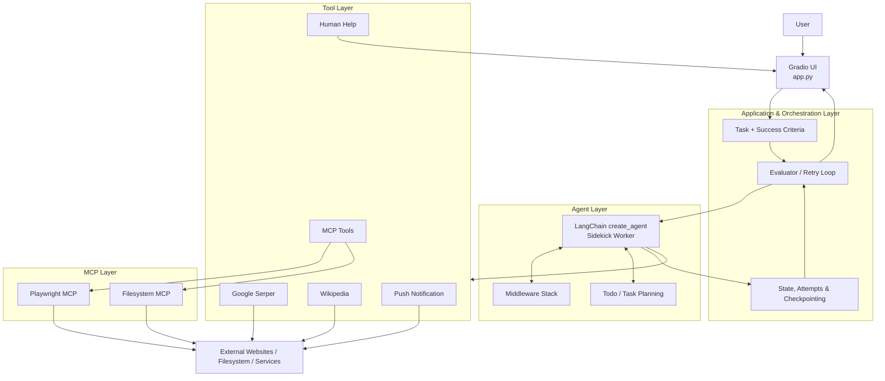
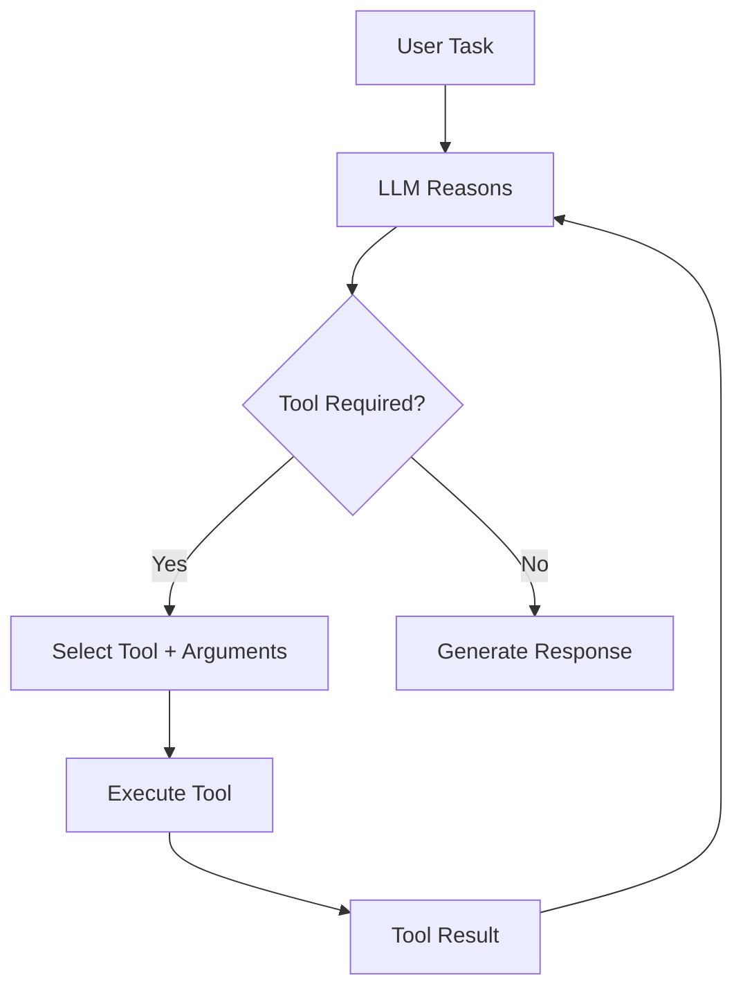
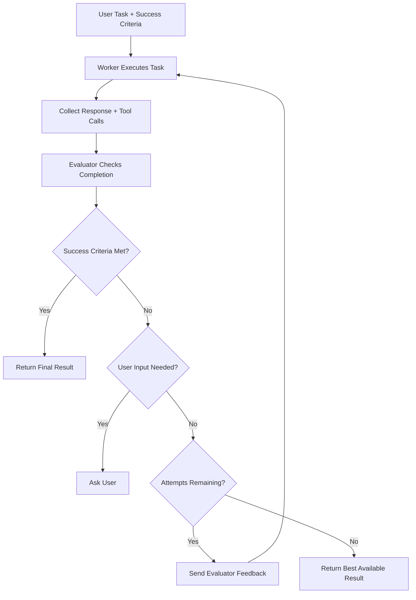
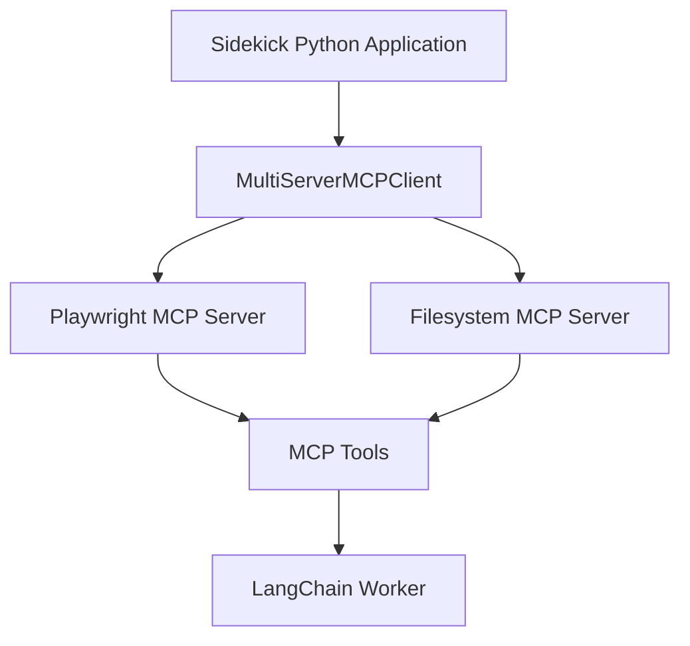
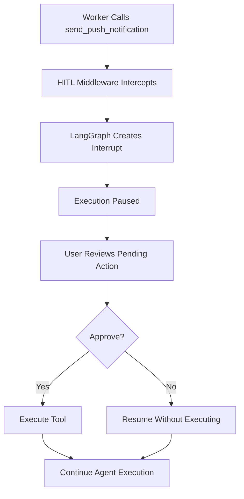

# Sidekick – AI Personal Assistant & Autonomous Task Execution Agent

Sidekick is an AI-powered personal assistant designed to execute multi-step tasks autonomously using an LLM, browser automation, web search, filesystem operations, and external tools.

Unlike a conventional chatbot that primarily generates responses, Sidekick acts as an **AI coworker**. It accepts a task along with explicitly defined success criteria, creates and executes a plan, interacts with external systems, evaluates its own progress, and continues working until the objective is achieved or human assistance is required.

The project combines **LangChain, LangGraph, MCP (Model Context Protocol), middleware, structured output evaluation, and human-in-the-loop execution** into a single agentic system.

---

## 1. What Is Sidekick?

Sidekick is a task-oriented AI agent that can interact with the real world through tools.

A user provides two things:

1. **Task:** What should the agent accomplish?
2. **Success Criteria:** How should the agent determine whether the task is completed successfully?

Sidekick then:

- Understands the task and breaks it into smaller steps.
- Creates and maintains a task plan.
- Uses browser automation to interact with websites.
- Searches the web and retrieves information.
- Reads and writes files in a controlled sandbox.
- Uses external tools to perform actions.
- Evaluates its output against the user's success criteria.
- Retries when the evaluation indicates that more work is required.
- Pauses for human approval before performing configured sensitive actions.

The central idea is to move beyond simple LLM responses toward **goal-oriented task execution with feedback, tool usage, and controlled autonomy**.

## 2. Problem Statement

Traditional LLM-based chatbots have several limitations when handling real-world tasks.

| Problem | How Sidekick addresses it |
|---|---|
| LLMs primarily generate text rather than execute tasks | Connects the model to browser, filesystem, search, and external tools |
| Complex tasks require multiple steps | Uses an agent with a planning mechanism and tool-calling capabilities |
| Agents may stop after producing incomplete results | Uses an evaluator loop to check task completion |
| Tool execution can fail | Uses custom middleware to return tool errors to the agent for recovery |
| Autonomous actions can be risky | Uses Human-in-the-Loop middleware for approval |
| Browser and filesystem interactions require external integrations | Uses MCP servers to expose these capabilities |
| Long-running tasks need execution continuity | Uses LangGraph checkpointing and persistent MCP sessions |

**The main problem Sidekick solves:** How can an LLM-based assistant reliably execute multi-step tasks using external tools while maintaining control, evaluating progress, and involving a human when necessary?

---

## 3. Key Features

### Autonomous Task Execution
- Accepts natural-language tasks.
- Executes multi-step workflows.
- Uses available tools based on the task.
- Continues working until success criteria are met or user input is required.

### Browser Automation
- Opens and navigates websites.
- Reads webpage content.
- Performs browser interactions using Playwright MCP.
- Supports real-world browsing workflows.

### Web Search and Information Retrieval
- Searches the web using Google Serper.
- Retrieves information from Wikipedia.
- Uses search results as evidence while completing tasks.

### Filesystem Operations
- Reads and writes files through Filesystem MCP.
- Stores generated outputs inside a dedicated sandbox directory.
- Can create reports, notes, and other task-related files.

### Planning and Progress Tracking
- Uses `TodoListMiddleware` to maintain a task plan.
- Updates task progress during execution.
- Displays the current plan in the Gradio interface.

### Evaluator and Retry Mechanism
- Evaluates the worker's response against user-defined success criteria.
- Considers tool-call evidence.
- Provides feedback when the task is incomplete.
- Allows the worker to retry up to a configured maximum.

### Human-in-the-Loop
- Pauses before configured sensitive actions.
- Requests approval before sending push notifications.
- Allows the user to intervene during browser-based workflows.
- Resumes execution using LangGraph checkpointing.

### Safety and Reliability
- PII redaction through middleware.
- Model-call limits to prevent excessive execution.
- Tool-error handling for recovery.
- Restricted filesystem access through the sandbox.

---

## 4. Architecture Overview

Sidekick follows a **stack-not-a-ladder architecture**. Instead of relying on a single framework to manage everything, it combines components from different abstraction levels.

The main architecture consists of:

1. Application Layer – Gradio interface and task orchestration.
2. Agent Layer – LangChain `create_agent` worker and evaluator loop.
3. Tool Layer – Python tools and integrations.
4. MCP Layer – Browser and filesystem servers.
5. External Systems – Websites, search services, filesystem, and notification services.

### High-Level Architecture



### Understanding the Layers

**Layer 1 – Tools**

The actual capabilities that allow the agent to interact with external systems.

Examples:
- Web search
- Wikipedia lookup
- Push notifications
- Browser automation
- Filesystem operations

**Layer 2 – Orchestration**

Manages execution state, checkpointing, task evaluation, and retries.

Examples:
- LangGraph checkpointer
- Evaluator loop
- Human-in-the-loop interruptions
- Task execution state

**Layer 3 – Agent**

The main reasoning and tool-calling component built using LangChain's `create_agent`.

It decides:
- What needs to be done.
- Which tool to call.
- What arguments to provide.
- Whether additional steps are required.

The application-level evaluator loop wraps this worker and manages the overall task lifecycle.

---

## 5. Core Working: How Sidekick Executes a Task

This is the most important part of the project.

Sidekick does not simply send the user's message to an LLM and return the response. It follows an execution-and-evaluation cycle.

### Step 1: User Provides a Task

The user submits a task and its success criteria through the Gradio interface.

Example:

**Task:**

```text
Find me the best round-trip flight from New York to London,
leaving about a month from now and returning a week later.

I care about price first, then total journey time,
and I would rather avoid itineraries with two or more stops.

Write the top three options to flights.md,
then send me a push notification with the price of your top pick.
```

**Success Criteria:**

```text
flights.md is written with three specific options including
airline, times and price, plus a clear recommendation,
and a push notification was sent with the recommended price.
```

The task describes the desired outcome, while the success criteria define what completion means.

This separation is important because an agent can produce a convincing response without actually completing the requested actions.

### Step 2: Worker Receives the Task

The main worker is created using LangChain's `create_agent`.

```python
self.worker = create_agent(
    model="openai:gpt-5.4-mini",
    tools=self.tools,
    system_prompt=WORKER_PROMPT,
    middleware=[
        TolerateToolErrors(),
        TodoListMiddleware(),
        PIIMiddleware("email"),
        PIIMiddleware(
            "credit_card",
            apply_to_tool_results=True
        ),
        ModelCallLimitMiddleware(run_limit=30),
        HumanInTheLoopMiddleware(
            interrupt_on={
                "send_push_notification": True,
                "request_human_help": True
            }
        ),
    ],
    checkpointer=self.memory,
)
```

The worker receives the user's task, success criteria, system instructions, and available tools.

`create_agent` handles the underlying agent execution graph, including model calls, tool execution, middleware, and conditional transitions.

The worker is responsible for reasoning and executing the task, while the surrounding Sidekick application controls the overall evaluation and retry process.

### Step 3: Task Planning

Before performing a complex task, the worker can create a list of smaller steps.

This functionality is provided by:

```python
TodoListMiddleware()
```

For the flight-search task, the plan might contain steps such as:

```text
1. Search for available flights.
2. Compare prices and journey durations.
3. Filter out itineraries with two or more stops.
4. Select the best three options.
5. Write the results to flights.md.
6. Send a push notification.
```

The exact plan is generated by the agent, not hardcoded.

The middleware maintains the todo list, and the Gradio interface displays its progress.

### Step 4: Tool Selection and Execution

The worker determines which tools are required to complete each step.

For example:

| Requirement | Tool |
|---|---|
| Search the internet | Google Serper |
| Retrieve Wikipedia information | Wikipedia |
| Browse flight websites | Playwright MCP |
| Save flight results | Filesystem MCP |
| Send a notification | Pushover tool |
| Request human assistance | `request_human_help` |

The LLM decides when and how to use these tools based on the task.

The tools themselves execute the requested operations and return their results to the agent.

This is the central tool-calling cycle:



The worker can perform multiple tool calls in sequence until it has enough information to proceed or complete the task.

### Step 5: Evaluator Checks the Result

After the worker finishes an execution attempt, Sidekick invokes a separate evaluator model.

The evaluator is initialized using structured output:

```python
self.evaluator = ChatOpenAI(
    model="gpt-5.4-mini"
).with_structured_output(EvaluatorOutput)
```

The evaluator returns a structured response:

```python
class EvaluatorOutput(BaseModel):
    feedback: str = Field(
        description="Feedback on the assistant's response"
    )

    success_criteria_met: bool = Field(
        description="Whether the success criteria have been met"
    )

    user_input_needed: bool = Field(
        description="True if the assistant has a question, needs clarification, or is stuck and needs the user"
    )
```

The evaluator receives:

- Original user request.
- User-defined success criteria.
- Tool calls performed by the worker.
- Latest worker response.

It checks whether the task has actually been completed.

For example:

```text
Success Criteria:
flights.md must contain three flight options,
including airline, times, prices and a recommendation.
```

The evaluator should not consider the task successful merely because the worker says that it created the file. The tool-call evidence helps it assess whether the requested operation was performed.

### Step 6: Evaluator Feedback and Retry Loop

If the evaluator determines that the success criteria have not been met, Sidekick sends its feedback to the worker.

The worker then gets another opportunity to complete the missing steps.

The maximum number of attempts is controlled by:

```python
MAX_ATTEMPTS = 3
```

The execution logic can be understood as:



The loop terminates when:

1. The success criteria are met.
2. The evaluator determines that user input is needed.
3. The maximum number of attempts is reached.

This evaluator loop is implemented at the application level in `sidekick.py`, rather than being delegated to another agent framework.

**Why is this important?**

Without an evaluator, an agent may stop after producing an incomplete result. The evaluator introduces a feedback mechanism that allows the worker to identify missing requirements and attempt to fix them.

---

## 6. MCP – Model Context Protocol

MCP is a major part of Sidekick's architecture.

The Model Context Protocol provides a standardized way for AI applications to connect to external tools and resources.

Instead of implementing browser automation and filesystem operations from scratch, Sidekick connects to existing MCP servers.

This project uses two MCP servers.

### 6.1 Playwright MCP

Playwright MCP provides browser automation capabilities.

It allows Sidekick to:

- Open websites.
- Navigate between pages.
- Read webpage content.
- Interact with browser elements.
- Perform multi-step browser workflows.

The MCP connection is configured using:

```python
"playwright": {
    "transport": "stdio",
    "command": "npx",
    "args": [
        "@playwright/mcp@latest",
        "--isolated"
    ],
}
```

The server runs as a separate process and communicates with the Python application through standard input/output.

### 6.2 Filesystem MCP

Filesystem MCP allows the agent to interact with files.

It provides capabilities such as:

- Reading files.
- Writing files.
- Creating files.
- Listing directory contents.
- Managing files within the permitted directory.

Configuration:

```python
"filesystem": {
    "transport": "stdio",
    "command": "npx",
    "args": [
        "-y",
        "@modelcontextprotocol/server-filesystem",
        sandbox
    ],
}
```

Notice that the sandbox directory is passed to the server.

This restricts filesystem access to the designated workspace rather than exposing the entire machine.

### 6.3 Connecting MCP Servers to LangChain

The project uses:

```python
from langchain_mcp_adapters.client import MultiServerMCPClient
from langchain_mcp_adapters.tools import load_mcp_tools
```

The `MultiServerMCPClient` manages connections to multiple MCP servers.

The `load_mcp_tools` function makes the tools exposed by those servers available to the LangChain agent.

The overall flow is:



### 6.4 Persistent MCP Sessions

One important implementation detail is that Sidekick maintains persistent MCP sessions during its lifetime.

The `McpSessions` class in `sidekick_tools.py` manages these sessions using:

- `AsyncExitStack`
- Background asyncio task
- Readiness signaling
- Stop signaling
- MCP client lifecycle management

Why persistent sessions?

Browser automation often requires maintaining state between tool calls.

For example:

1. Open a website.
2. Navigate to a search page.
3. Enter search criteria.
4. Read the results.
5. Continue interacting with the same browser session.

If the browser session were recreated for every operation, maintaining this workflow would be more difficult.

Persistent sessions allow the browser to retain its state between tool calls and support handing control to a human during a task.

The `cleanup()` method stops the sessions when Sidekick is reset or shut down.

---

## 7. Middleware Architecture

Middleware adds additional behavior around agent and tool execution without requiring all of that logic to be implemented inside the worker itself.

Sidekick uses both built-in LangChain middleware and custom middleware.

### 7.1 TodoListMiddleware

```python
TodoListMiddleware()
```

Purpose:
- Enables task planning.
- Maintains a todo list.
- Tracks progress across task execution.
- Makes the plan available to the application UI.

This is useful for complex tasks that require multiple operations.

### 7.2 PIIMiddleware

Sidekick uses two PII middleware configurations.

```python
PIIMiddleware("email")
```

Protects email addresses by applying PII handling to the relevant model input.

```python
PIIMiddleware(
    "credit_card",
    apply_to_tool_results=True
)
```

Also applies credit-card redaction to tool results.

This matters because sensitive information may appear in content retrieved from external websites or other tools.

### 7.3 ModelCallLimitMiddleware

```python
ModelCallLimitMiddleware(run_limit=30)
```

Purpose:

Limits the number of model calls during a run.

Why?

An agent may get stuck in repetitive reasoning or tool-calling loops. A model-call limit provides an additional safeguard against excessive execution and API usage.

### 7.4 HumanInTheLoopMiddleware

```python
HumanInTheLoopMiddleware(
    interrupt_on={
        "send_push_notification": True,
        "request_human_help": True
    }
)
```

This middleware introduces human approval into the agent's workflow.

In Sidekick, it pauses execution before:

- Sending a push notification.
- Requesting human assistance.

When an intercepted tool call occurs, LangGraph generates an interrupt and pauses execution.

The user can then review and approve the pending action.

### 7.5 Custom TolerateToolErrors Middleware

Sidekick also implements custom error-handling middleware.

```python
class TolerateToolErrors(AgentMiddleware):

    async def awrap_tool_call(self, request, handler):
        try:
            return await handler(request)

        except Exception as error:
            return ToolMessage(
                content=(
                    f"That tool call failed: {error}. "
                    "Try another approach."
                ),
                tool_call_id=request.tool_call["id"],
            )
```

Purpose:

- Catches tool execution errors.
- Converts exceptions into tool messages.
- Returns the error information to the model.
- Allows the worker to attempt an alternative approach.

For example, if a browser operation fails, the agent receives the failure as tool feedback instead of immediately terminating the entire task.

### Middleware Summary

| Middleware | Responsibility |
|---|---|
| `TodoListMiddleware` | Planning and task progress |
| `PIIMiddleware` | Sensitive information redaction |
| `ModelCallLimitMiddleware` | Limits model calls |
| `HumanInTheLoopMiddleware` | Approval and human intervention |
| `TolerateToolErrors` | Tool error handling and recovery |

---

## 8. Human-in-the-Loop (HITL)

Autonomous agents should not perform every action without human supervision.

Some operations require explicit user approval or human participation.

Sidekick implements this using:

- `HumanInTheLoopMiddleware`
- LangGraph checkpointing
- `Command(resume=...)`

### How It Works

Suppose the agent has completed the flight search and created `flights.md`.

The next step is to send a push notification.

Because `send_push_notification` is configured for human approval, execution pauses before the notification is sent.

The workflow becomes:



### Checkpointing

Sidekick uses:

```python
from langgraph.checkpoint.memory import InMemorySaver

self.memory = InMemorySaver()
```

The checkpointer stores graph execution state.

This allows the interrupted agent execution to resume from its saved state rather than restarting the entire task.

### Resuming Execution

The project implements a `resume()` method:

```python
payload = Command(
    resume={
        "decisions": [
            {"type": "approve"}
        ] * self.pending_actions
    }
)

return await self._advance(payload, history)
```

The resume command tells LangGraph to approve the pending actions and continue execution.

The middleware can also support other decisions, such as editing or rejecting a tool call, depending on its configuration. The Sidekick application's current resume implementation uses approval.

### Human Assistance During Browser Tasks

Sidekick also provides a custom tool:

```python
@tool
def request_human_help(instructions: str) -> str:
    return "The user says it is done. Continue with the task."
```

This is useful when the browser reaches a task that requires a human, such as:

- Logging into an account.
- Solving a CAPTCHA.
- Completing two-factor authentication.

The agent requests human assistance, pauses, and allows the user to perform the required action in the browser.

Once the user indicates that the action is complete and resumes execution, the agent continues its workflow.

---

## 9. Tools and Integrations

Sidekick combines custom Python tools, community tools, and MCP-provided tools.

### Custom Tools

**Push Notification Tool**

Implemented using Pushover's HTTP API.

```python
@tool
def send_push_notification(text: str) -> str:

    response = requests.post(
        "https://api.pushover.net/1/messages.json",
        data={
            "token": os.getenv("PUSHOVER_TOKEN"),
            "user": os.getenv("PUSHOVER_USER"),
            "message": text,
        },
    )

    response.raise_for_status()

    return "Notification sent"
```

This allows the agent to send notifications to the user's device.

**Human Help Tool**

```python
@tool
def request_human_help(instructions: str) -> str:
    return "The user says it is done. Continue with the task."
```

This provides a way for the agent to request human intervention during a workflow.

### Community Tools

**Google Serper**

```python
search = GoogleSerperRun(
    api_wrapper=GoogleSerperAPIWrapper()
)
```

Used for web search and retrieving relevant information.

**Wikipedia**

```python
wikipedia_lookup = WikipediaQueryRun(
    api_wrapper=WikipediaAPIWrapper()
)
```

Used for retrieving information from Wikipedia.

### MCP Tools

- Playwright MCP – browser automation.
- Filesystem MCP – file and directory operations.

All tools are collected and passed to the worker through:

```python
self.tools, self.sessions = await get_all_tools(SANDBOX)
```

The agent can then decide which tools to use during execution.

---

## 10. Codebase Explanation

The project is organized into separate modules, each responsible for a specific part of the application.

```text
sidekick/
│
├── app.py
├── sidekick.py
├── sidekick_tools.py
├── styles.py
├── side_kit.py
│
├── sandbox/
│
├── .env
├── .gitignore
├── requirements.txt
└── README.md
```

### `sidekick.py` – Main Agent and Orchestration

This is the core of the project.

Responsibilities:

- Defines the worker and evaluator.
- Creates the LangChain agent using `create_agent`.
- Configures middleware.
- Maintains the task and success criteria.
- Executes the worker.
- Evaluates the worker's response.
- Manages retries and execution limits.
- Handles human approval and resumption.
- Maintains execution state through checkpointing.

Important methods:

| Method | Responsibility |
|---|---|
| `setup()` | Initializes tools, MCP sessions, worker and evaluator |
| `evaluate()` | Evaluates task completion against success criteria |
| `run_turn()` | Starts a new task |
| `_advance()` | Controls worker execution, evaluation and retries |
| `resume()` | Resumes an interrupted task |
| `cleanup()` | Stops MCP sessions and releases resources |

### `sidekick_tools.py` – Tools and MCP Integration

Responsibilities:

- Initializes Google Serper and Wikipedia.
- Defines custom Python tools.
- Configures MCP server connections.
- Creates and maintains persistent MCP sessions.
- Loads tools exposed by MCP servers.
- Combines all tools into a single list for the agent.

Important components:

| Component | Responsibility |
|---|---|
| `send_push_notification()` | Sends push notifications |
| `request_human_help()` | Requests human intervention |
| `mcp_connections()` | Defines MCP server configurations |
| `McpSessions` | Manages persistent MCP sessions |
| `get_all_tools()` | Combines custom, community and MCP tools |

### `app.py` – User Interface

The Gradio application provides the interaction layer.

It includes:

- Chat interface.
- Task input field.
- Success criteria input field.
- Live task plan.
- Go button to start execution.
- Approve and continue button for interrupted tasks.
- Reset functionality.

The UI communicates with the `Sidekick` class and displays its responses and progress.

### `styles.py` – UI Styling

Contains:

- Gradio theme configuration.
- CSS styling.
- JavaScript configuration for the interface.

It separates the visual design from the agent logic.

### `side_kit.py` – PowerPoint Generation Helper

Contains helper functions for creating branded PowerPoint slides.

It uses `python-pptx` to generate presentation slides with predefined colors, titles, key points, recommendations, and branding.

This is an auxiliary presentation-generation component rather than part of the core agent execution loop.

### `sandbox/` – Agent Workspace

The sandbox is the working directory exposed to the Filesystem MCP server.

The agent can create and manage files inside this directory.

For example:

```text
sandbox/
│
├── flights.md
├── research_report.md
└── ...
```

These files are generated as needed during task execution. You do not need to create every output file beforehand.

---

## 11. End-to-End Execution Example

The flight-search task demonstrates how the different components work together.

### User Request

```text
Find the best round-trip flight from New York to London.

Prioritize price, then journey time.
Avoid flights with two or more stops.

Write the top three options to flights.md
and send me a push notification with the top recommendation.
```

### Execution Flow

**1. Task initialization**

The Gradio interface sends the task and success criteria to `Sidekick.run_turn()`.

**2. Planning**

The worker creates a todo list containing the required steps.

**3. Browser automation**

The worker uses Playwright MCP to open Google Flights and search for flight options.

**4. Information collection**

It reads the results and compares airline, price, journey time, and number of stops.

**5. File generation**

The worker uses Filesystem MCP to create `sandbox/flights.md` and write the top three options with a recommendation.

**6. Push notification request**

The worker calls `send_push_notification`.

**7. Human approval**

HumanInTheLoopMiddleware intercepts the notification call. Execution pauses and the Gradio interface displays the approval option.

**8. Resume**

The user approves the pending action. The application calls `Sidekick.resume()`, which resumes the interrupted LangGraph execution.

**9. Notification delivery**

The Pushover tool executes and sends the notification.

**10. Evaluation**

The evaluator checks whether the requested file and notification requirements have been satisfied, using the worker's response and tool-call history as evidence.

**11. Final response**

If the criteria are met, Sidekick returns the final result. Otherwise, it can provide feedback to the worker and allow another attempt, subject to its execution limits.

This example demonstrates how reasoning, planning, browser automation, filesystem operations, human approval, checkpointing, and evaluation work together in a single task.

---

## 12. Technology Stack

| Category | Technology | Purpose |
|---|---|---|
| Language | Python | Main application development |
| LLM | OpenAI GPT-5.4-mini | Worker and evaluator |
| Agent Framework | LangChain | Agent creation and tool calling |
| Orchestration | LangGraph | Execution state, interrupts and checkpointing |
| Agent Creation | `create_agent` | Worker construction |
| Structured Output | Pydantic | Evaluator response schema |
| Middleware | LangChain Middleware | Planning, PII protection, limits and HITL |
| MCP Integration | `langchain-mcp-adapters` | Connect MCP servers to LangChain |
| Browser Automation | Playwright MCP | Website interaction |
| Filesystem | Filesystem MCP | File operations |
| Web Search | Google Serper | Search engine integration |
| Knowledge Retrieval | Wikipedia | Wikipedia search |
| Notifications | Pushover API | Push notifications |
| UI | Gradio | Interactive web interface |
| HTTP Requests | Requests | API communication |
| Environment Management | python-dotenv | Environment variable loading |
| Package Management | pip | Python dependency installation |
| External Runtime | Node.js / npx | Launch MCP servers |

---

## 13. Installation and Setup

### Prerequisites

- Python 3.12
- Node.js (LTS)
- npm
- OpenAI API key
- Google Serper API key
- Pushover credentials (if using push notifications)

### Step 1: Clone the Repository

```bash
git clone <your-repository-url>

cd sidekick
```

### Step 2: Create a Virtual Environment

```bash
python -m venv .venv
```

Activate it:

**Windows:**

```bash
.venv\Scripts\activate
```

**Linux / macOS:**

```bash
source .venv/bin/activate
```

### Step 3: Install Dependencies

```bash
pip install -r requirements.txt
```

### Step 4: Configure Environment Variables

Create a `.env` file in the project root:

```env
OPENAI_API_KEY=your_openai_api_key

SERPER_API_KEY=your_serper_api_key

PUSHOVER_TOKEN=your_pushover_application_token
PUSHOVER_USER=your_pushover_user_key
```

Keep your API keys private. Never commit `.env` to GitHub.

### Step 5: Create the Sandbox Directory

```bash
mkdir sandbox
```

The application also creates this directory during setup if it does not exist.

### Step 6: Run the Application

```bash
python app.py
```

The Gradio application will start and provide a local URL in the terminal.

Open the URL in your browser to interact with Sidekick.

---

## 14. Example Tasks

Sidekick can be given different tasks depending on the tools and external services available.

### Example 1: Web Research

```text
Visit Hacker News and tell me the title of the
current top story.

Success Criteria:
The response must name a specific story currently
displayed on the Hacker News front page.
```

### Example 2: Flight Research

```text
Find the best round-trip flights from New York to London.

Prioritize price, then total journey time.
Avoid itineraries with two or more stops.

Write the top three options to flights.md.

Success Criteria:
The file must contain three specific options,
including airline, times, prices and a recommendation.
```

### Example 3: Research and File Generation

```text
Research a topic using web search and browser automation.

Summarize the important findings and save the report
as research_report.md.

Success Criteria:
The report must contain the main findings,
supporting information and a clear conclusion.
```

The actual capabilities depend on the available tools, website accessibility, and external service permissions.

---

## 15. Important Engineering Concepts Demonstrated

This project brings together several important concepts in production-oriented agent development.

**1. Agentic Workflow Design**

Building an agent that can reason, plan, execute tools, and continue working toward a goal rather than simply responding to a prompt.

**2. Tool Calling and Integration**

Connecting LLMs to Python functions, search services, browser automation, filesystem operations, and external APIs.

**3. MCP (Model Context Protocol)**

Using a standardized protocol to expose external capabilities to an AI application without implementing every integration from scratch.

**4. Agent Middleware**

Applying cross-cutting capabilities such as planning, PII redaction, model-call limits, error handling, and human approval.

**5. Evaluator and Feedback Loops**

Separating task execution from task evaluation and using structured feedback to improve incomplete results.

**6. Human-in-the-Loop Execution**

Introducing human approval and intervention into autonomous workflows.

**7. Stateful Agent Execution**

Using LangGraph checkpointing and persistent MCP sessions to preserve execution state across interruptions and tool calls.

**8. Modular Application Architecture**

Separating agent orchestration, tools, MCP integration, UI, and styling into dedicated modules.

---

## 16. Current Limitations and Future Improvements

The project demonstrates an extensible agent architecture, but it can be improved further.

Potential improvements:

- Add persistent checkpoint storage instead of relying only on `InMemorySaver`.
- Add authentication and user-specific sessions.
- Add structured logging and execution tracing.
- Add more granular approval policies for filesystem operations and other sensitive tools.
- Improve evaluator reliability with explicit artifact verification.
- Add automated tests for tools, middleware, and task execution.
- Add better retry strategies and failure classification.
- Add support for additional MCP servers and external integrations.
- Add deployment support for multi-user access.
- Add monitoring for model usage, execution time, and tool failures.

---

## 17. Conclusion

Sidekick demonstrates how multiple components of the modern agentic AI ecosystem can be combined to build a practical AI personal assistant.

The core design is a **LangChain `create_agent` worker wrapped in a custom evaluator and retry loop**, supported by LangGraph checkpointing, middleware, custom tools, and persistent MCP connections.

The most important architectural idea is that an autonomous agent needs more than an LLM and a collection of tools. It also needs a way to plan tasks, observe execution results, evaluate whether the objective has been achieved, recover from failures, and involve a human when necessary.

Sidekick brings these ideas together into an extensible task-execution system.

**Core takeaway:** The project moves from an LLM that answers questions to an agent that can plan, interact with external systems, execute actions, evaluate outcomes, and work toward a clearly defined goal.

---

## Author

**Mazhar Ahmad**

*Built as a hands-on project exploring LangChain, LangGraph, MCP, middleware, and autonomous AI agent architectures.*
